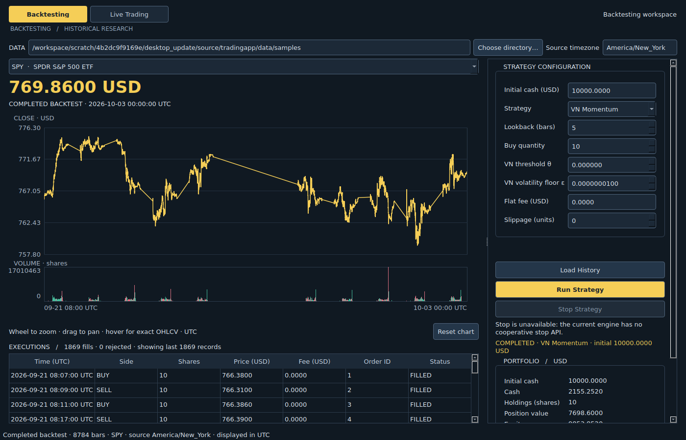
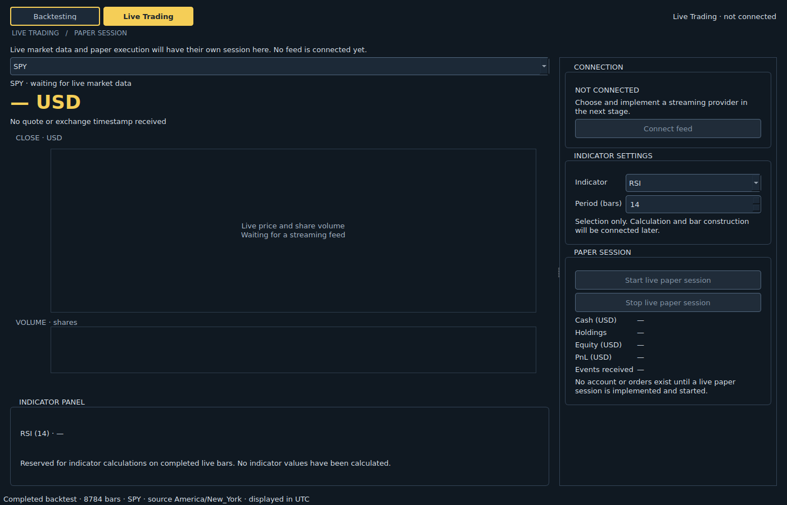

# TRADINGAPP

**An event-driven C++20 backtesting engine with a Qt desktop interface.**


TRADINGAPP brings historical market data, trading strategies, simulated execution, and portfolio accounting into one desktop application. Select an instrument, configure a strategy, run a backtest, and inspect the price chart, executions, and final account values.

Built as a quantitative development portfolio project, it focuses on explicit
execution assumptions, exact monetary arithmetic, and separation between the
trading engine and its user interface.

**Current release:** historical backtesting is implemented. A separate Live Trading
workspace is available as a UI foundation; streaming data and live paper execution
are planned and are not connected yet.

## Preview

### Historical backtesting



<!-- <details>
<summary>Live Trading workspace — interface foundation</summary>



The live page has independent instrument and indicator settings. Prices and
account values remain unavailable until a streaming feed and paper session are
implemented.

</details> -->

## Features

- **Interactive backtests:** choose a historical dataset and configure initial capital, strategy parameters, flat fees, and slippage.
- **Exact accounting:** cash and prices use signed 64-bit fixed-point values at USD 0.0001 precision; quantities are whole shares.
- **Explicit event timing:** strategies observe completed bars; historical orders use the next eligible bar-open fill model.
- **Market visualization:** closing-price line, aligned share-volume histogram, zoom, pan, and OHLCV tooltips.
- **Result inspection:** cash, positions, equity, realized/unrealized PnL, fees, and an execution table.
- **Background processing:** historical loading and simulation run outside the GUIt thread, with a processed-bar counter during execution.
- **Independent workspaces:** switch between Backtesting and Live Trading while preserving the backtest page's state.

### Available strategies

| Strategy | Purpose |
|---|---|
| DoNothing | Baseline account behavior without strategy orders. |
| Momentum | Trading decisions based on completed-bar price momentum. |
| VN Momentum | Momentum normalized by estimated return volatility, with configurable threshold and volatility floor. |

A scripted strategy is also available in the core; the GUI does not include a
scripted-decision editor.

## Architecture

The desktop calls the C++ trading library directly. It does not launch a CLI or test executable to obtain results.

| Layer | Responsibility |
|---|---|
| `apps/gui/main.cpp` | Application startup, shared styling, page navigation, and window coordination. |
| `BackTestingPage` | Historical inputs, per-symbol settings, background jobs, and result presentation. |
| `LiveTradingPage` | Independent workspace for future streaming data, indicators, and paper execution. |
| Trading API adapter | Adapter between the desktop and the existing engine. |
| `src/marketdata`, `src/storage` | Feed abstraction, CSV validation, and timestamp normalization. |
| `src/strategy`, `src/engine` | Strategy creation and event-driven simulation. |
| `src/execution`, `src/portfolio` | Paper execution, order handling, and fixed-point accounting. |
| `src/simulation`, `src/core`, `src/utils` | Component factories, domain types, logging, and timing helpers. |

The trading library uses namespace `trading_app_cli`; Qt components use
`trading_app_desktop`. BackTestingPage owns its widgets, settings, timer, and
future watcher, and notifies the main window through Qt signals.

## Getting started

### Requirements

- Linux desktop environment.
- C++20-capable compiler.
- CMake 3.16 or newer, subject to the selected Qt kit's requirements.
- Qt 6: **Core, Gui, Widgets, and Concurrent**.
- Howard Hinnant **date v3.0.3** and a local OS timezone database.

### Build and launch

```bash
git clone https://github.com/QuangTrucDam/TRADINGAPP.git
cd TRADINGAPP
```

If the date dependency is not already present under `external/date`, obtain it:

```bash
mkdir -p external
git clone --depth 1 --branch v3.0.3 \
    https://github.com/HowardHinnant/date.git external/date
```

Configure and build the desktop target:

```bash
cmake -S . -B build \
    -DTRADING_BUILD_GUI=ON \
    -DBUILD_TESTING=OFF

cmake --build build --target trading_gui -j2
./build/trading_gui
```

If CMake cannot locate Qt, add its actual desktop-kit prefix. For example:

```bash
cmake -S . -B build \
    -DTRADING_BUILD_GUI=ON \
    -DBUILD_TESTING=OFF \
    -DCMAKE_PREFIX_PATH="$HOME/Qt/6.5.3/gcc_64"
```

Adjust the example path to your installation. If using the project's QT_ROOT
setting or environment override, ensure it points to the same intended Qt kit. CMake is the supported build method; no qmake project is maintained.

### Run a backtest

1. Open the **Backtesting** page.
2. Choose the directory containing your historical CSV files.
3. Select an instrument and confirm the source timezone.
4. Use **Load History** for preview, or configure the strategy and select
   **Run Strategy** for a fresh simulation.
5. Inspect the completed chart, portfolio values, and execution records.

The instrument list contains **SPY, AAPL, AMZN, GOOGL, NVDA, and TSLA**. Settings are retained separately for each symbol during the application session.

## Historical data

The feed expects a headerless one-minute CSV named `<SYMBOL>_1min.csv`, such as `SPY_1min.csv`, with columns in this order:

**DateTime, Open, High, Low, Close, Volume**

```csv
2026-09-21 04:00:00,764,766.24,764,766.24,7985
2026-09-21 04:01:00,766.12,766.36,764.68,766.3069,3512
```

Timestamps are source-local bar starts. Declare the timezone explicitly in theGUI; results display UTC. The default is `America/New_York`, but the actual sourceconvention must be confirmed for each dataset. Prices support up to four decimalplaces; volume is a nonnegative whole-share quantity. The parser validates fields,OHLC relationships, and the feed's ordering/time requirements.

The GUI's fee field is a **flat USD amount per fill**, not a percentage. Slippageis expressed in absolute price units: 10,000 units equal USD 1.

## Current scope

| Capability | Status |
|---|---|
| Historical preview and strategy execution | Implemented |
| Interactive price/volume chart and account inspection | Implemented |
| Separate Backtesting and Live Trading pages | Implemented |
| Live-page RSI/SMA/EMA and period selection | UI only; calculations not connected |
| Streaming market-data connection | Planned |
| Live paper execution and session recording | Planned |
| Cooperative strategy Stop | Planned; current button is disabled |

Charts and account values update after the historical job finishes. Closing thewindow during a job waits for completion. The desktop currently limits jobs to 100,000 bars and displays the latest 5,000 execution records. Inputs are not persisted between launches.

Backtest execution assumes full fills under the configured next-bar-open model. It does not reproduce order-book queue position, partial fills, or real network latency. Corporate-action handling is not implemented. Results are simulations, not evidence of executable profits.

## Roadmap

- Integrate a streaming trade/quote feed with connection and data-quality monitoring.
- Build completed bars from live events and reuse existing bar-based strategies.
- Add cooperative lifecycle control, pre-trade risk checks, and richer paper execution.
- Record sessions for deterministic replay and compare historical/live behavior.
- Measure processing latency, queue delay, throughput, and memory usage.
- Extend toward order-book processing and tick-driven strategy interfaces.

## Author

Developed by [Quang Truc DAM](https://github.com/QuangTrucDam) as a C++ quantitative trading systems portfolio project.